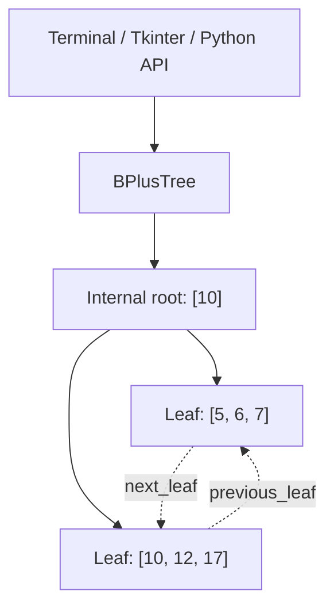

# Bplusproject ? B+ Tree Implementation Report

An educational, in-memory B+ tree in Python, with a terminal explorer, a Tkinter desktop interface, linked-leaf range queries, and Graphviz DOT export.

**Report date:** 13 November 2026  
**Original repository:** [mohammed-stalin/Bplusproject](https://github.com/mohammed-stalin/Bplusproject)  
**Runtime:** Python 3.10 or later; no third-party runtime dependencies.

## 1. Abstract

This project implements a balanced search tree for ordered, unique keys. Internal nodes route searches through separator keys; leaves store the actual keys and connect in both directions. Splitting handles growth, while sibling redistribution, merging, and root contraction handle deletion.

The revision addresses correctness problems in the original balancing logic, separates the data structure from user-interface messages, and supplies automated tests and reproducible execution instructions. It is intended for studying tree algorithms, rather than persistent database storage.

## 2. Objectives and scope

- Maintain sorted keys and equal leaf depth after insertion and deletion.
- Support membership checks and inclusive range queries.
- Explain tree structure through terminal and desktop views.
- Export diagrams without requiring a rendering package.
- Validate structural invariants against an independent reference model.

The tree behaves like an ordered set. Duplicate insertions do not change it. The Python API accepts mutually comparable keys, such as integers or strings; the interactive interfaces accept integers.

## 3. Getting started

From the directory containing your projects:

```sh
git clone https://github.com/mohammed-stalin/Bplusproject.git
cd Bplusproject
python main.py
```

If your system names Python 3 as `python3`, substitute that command. Direct execution does not require pip installation.

### Terminal explorer

```sh
python main.py --degree 4
```

| Option | Action |
| --- | --- |
| 1 | Insert an integer |
| 2 | Delete an integer |
| 3 | Display structure, sorted keys, and count |
| 4 | Exit |
| 5 | Search for an integer |
| 6 | Query an inclusive range |
| 7 | Export DOT to a chosen path |

Invalid integer input is handled without losing the session. EOF and Ctrl+C exit cleanly.

### Desktop explorer

```sh
python script.py
```

The Tkinter interface uses degree 4. It provides insert, delete, search, range queries, a live textual tree view, and a file picker for DOT export. Status messages distinguish successful changes from duplicates and absent keys.

Tkinter requires a graphical desktop and a Python installation with Tk support. Some Linux installations provide Tk separately through their system package manager. The core library and terminal interface work without Tkinter.

### Optional package installation

```sh
python -m venv .venv
# Windows PowerShell:
.venv\Scripts\Activate.ps1
# macOS/Linux:
# source .venv/bin/activate
python -m pip install .
bplus-tree --degree 5
```

Packaging uses setuptools as a build dependency. It is not required to run the source files directly.

## 4. Architecture

| File | Responsibility |
| --- | --- |
| `bplustree/bptree.py` | Search, insertion, deletion, balancing, iteration, and range queries |
| `bplustree/node.py` | Internal and leaf node structures |
| `bplustree/__init__.py` | Public class exports |
| `main.py` | Terminal interface and command-line arguments |
| `script.py` | Tkinter desktop explorer |
| `utils.py` | Text formatting and deterministic DOT export |
| `tests/test_tree.py` | Structural, randomized, API, export, and terminal tests |
| `pyproject.toml` | Package metadata and terminal entry point |
| `.github/workflows/tests.yml` | Windows/Linux Python test matrix |



Internal separator keys equal the minimum key in the child immediately to their right. Consequently, a search equal to a separator follows the right child.

## 5. Data structure and algorithms

### Degree and invariants

For degree `d >= 3`:

| Property | Rule |
| --- | --- |
| Maximum internal children | `d` |
| Maximum leaf keys | `d - 1` |
| Minimum non-root internal children | `ceil(d / 2)` |
| Minimum non-root leaf keys | `ceil((d - 1) / 2)` |
| Internal key count | Number of children minus one |
| Root | A leaf, or an internal node with at least two children |
| Leaf depth | Equal for every leaf |
| Leaf links | Both directions match ascending tree order |

An empty tree is represented by one empty root leaf.

### Insertion

1. Descend through internal separators using binary search.
2. Reject duplicates, otherwise insert into the destination leaf in sorted order.
3. Split an overflowing leaf and repair its neighboring leaf links.
4. Attach the new child to the parent, splitting internal nodes recursively when needed.
5. Create a new root if the split reaches the top.

### Deletion

1. Locate the key and return unchanged if it is absent.
2. Remove it from its leaf.
3. If the node is underfull, borrow from an adjacent sibling with surplus occupancy.
4. Otherwise merge adjacent siblings and repair child pointers or leaf links.
5. Rebalance the parent recursively and contract a root with only one child.
6. Refresh separators along the affected ancestor path.

### Cost and tradeoffs

Let `h` denote height, `d` degree, and `k` the number of returned keys. Binary routing costs `O(h log d)`; a range scan additionally visits matching leaf entries, giving `O(h log d + k)`. Full iteration costs `O(n)`.

Python list insertion/removal shifts up to `O(d)` entries per affected node. This implementation recomputes separators by walking to subtree minima, so mutation maintenance has a conservative upper bound of `O(d h?)` in addition to routing. This favors readable balancing logic over optimized cached subtree metadata. Storage is `O(n)`; range results allocate `O(k)` additional space.

## 6. Python API and example

```python
from bplustree import BPlusTree

tree = BPlusTree(degree=4)
for key in [10, 5, 12, 6, 7, 17]:
    tree.insert(key)

assert list(tree) == [5, 6, 7, 10, 12, 17]
assert tree.range_search(6, 12) == [6, 7, 10, 12]
assert 10 in tree
assert tree.insert(10) is False
assert tree.delete(10) is True
assert tree.delete(99) is False
assert len(tree) == 5
```

| API | Result |
| --- | --- |
| `BPlusTree(degree=4)` | Empty tree; invalid degree raises `ValueError` |
| `insert(key)` | `True` if added, `False` for a duplicate |
| `delete(key)` | `True` if removed, `False` if absent |
| `key in tree` | Membership boolean |
| `len(tree)` | Number of stored keys |
| `list(tree)` | Keys in ascending order |
| `range_search(lower, upper)` | Inclusive sorted result; reversed bounds yield `[]` |
| `search(key, node=None)` | Legacy `(index, leaf, found)` tuple; absent index is 0 |

The original import name `Bplustree` remains available as an alias. Library operations return results without printing. The internal node mutation methods from the initial implementation have been replaced; applications should use the tree API.

## 7. Visualization

Text display is built in:

```python
from utils import print_tree, export_dot

print_tree(tree.root)
export_dot(tree, "bplus_tree.dot")
```

For the example after deleting 10:

```text
Node [12]
   Leaf [5, 6, 7]
   Leaf [12, 17]
```

DOT source includes dashed forward leaf links and deterministic node identifiers. To render a PNG, install the optional Graphviz system application and run:

```sh
dot -Tpng bplus_tree.dot -o tree.png
```

Graphviz is only needed for rendering. The Python `graphviz` package is not required. The existing `bplus_tree.png` is retained as a historical artifact from the original repository; regenerate a diagram for current tree contents.

## 8. Validation and results

Run the complete automated suite from the repository root:

```sh
python -B -m unittest discover -s tests -v
```

Local validation on **13 November 2026**, using **Python 3.13.15 on Windows**, passed **9 tests**:

| Validation | Coverage |
| --- | --- |
| Degree checks | Invalid types, booleans, and values below three |
| Empty tree and duplicate handling | Missing deletions, duplicate insertions, single-key contraction |
| Growth and complete shrink | 160 inserts and 160 deletes, six degrees, ascending and descending deletion |
| Randomized model comparison | 16,800 mutations across six degrees and four deterministic seeds |
| Structural invariants | Occupancy, separators, ordering, parent pointers, equal depth, bidirectional links |
| Range and membership | Results compared with Python's `set` reference model |
| Comparable non-integer keys | String insertion, deletion, and range queries |
| Presentation and exports | Text output, deterministic DOT, UTF-8 file export |
| Interface behavior | Import safety, scripted terminal flow, bad input, invalid degree, EOF |

The randomized and growth/shrink tests inspect structural invariants after every mutation. These are correctness checks; no performance benchmark or production workload claim is made.

A disposable virtual environment successfully built and installed the package, ran the installed `bplus-tree --help` command, and verified insertion and deletion through the installed library.

A separate hidden Tkinter smoke check passed insertion, search, deletion, range queries, and live text display. Manual visual layout and export-dialog interaction remain useful desktop checks. PNG rendering was not tested because Graphviz was unavailable locally.

CI is configured for Python 3.10, 3.13, and 3.14 on Ubuntu and Windows. Those remote jobs will run when these changes are pushed; the local results above do not imply the CI matrix has already passed.

## 9. Improvements over the initial implementation

| Initial issue | Revision |
| --- | --- |
| Fragile deletion and root handling | Explicit borrowing, merging, and root contraction |
| Stale separators and inconsistent leaf links | Ancestor refresh and bidirectional link repair |
| Debug output mixed into algorithms | Quiet API with boolean operation results |
| Unvalidated degree and terminal input | Constructor and interface validation |
| Menu labels did not match actions | Explicit options with search, range, and export |
| GUI reported success for failed changes | Result-based status messages |
| Mandatory Graphviz import for the GUI | Built-in text visualization and dependency-free DOT |
| No documentation, tests, or packaging | Report README, regression suite, package metadata, and CI |
| Versioned Python bytecode | Cache exclusions and tracked-cache cleanup |

## 10. Limitations and future work

- Data lives in memory; there is no persistence, transaction log, or recovery mechanism.
- This is a unique-key set, without separate record payloads or duplicate-key buckets.
- Keys must be mutually comparable and maintain their ordering while stored.
- Concurrent mutation and mutation during iteration are unsupported.
- Nodes are exposed for educational inspection; modifying them directly can violate invariants.
- The GUI has fixed degree 4; use the terminal or Python API for other degrees.
- Very large datasets need benchmarking and potentially a storage-oriented design.

Potential extensions include key/value records, bulk loading, cached subtree metadata, persistent pages, and an interactive graphical node canvas.
